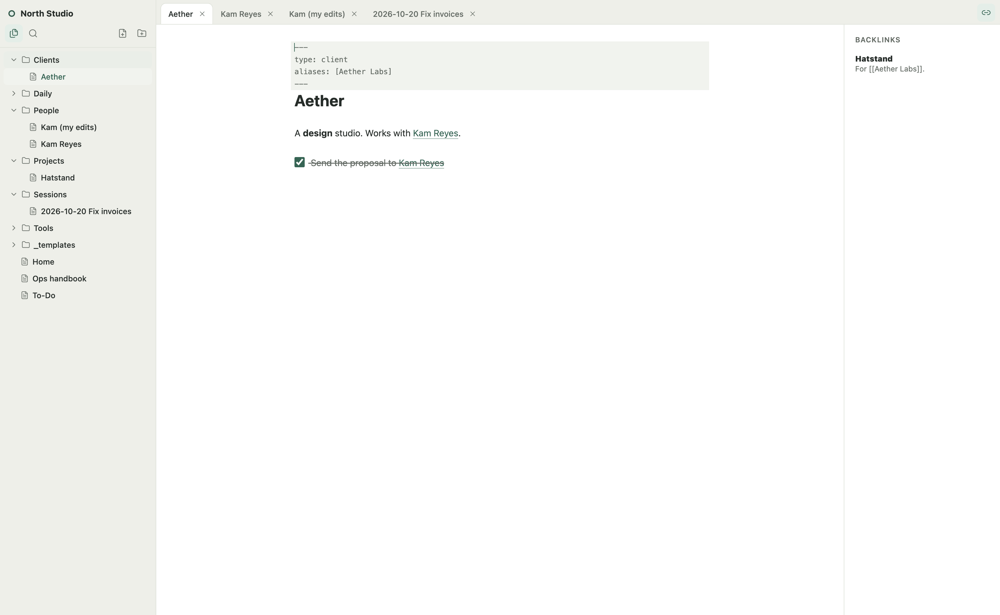
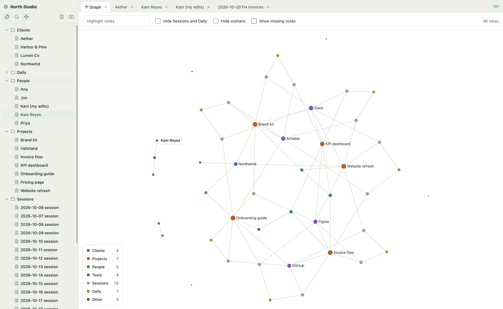
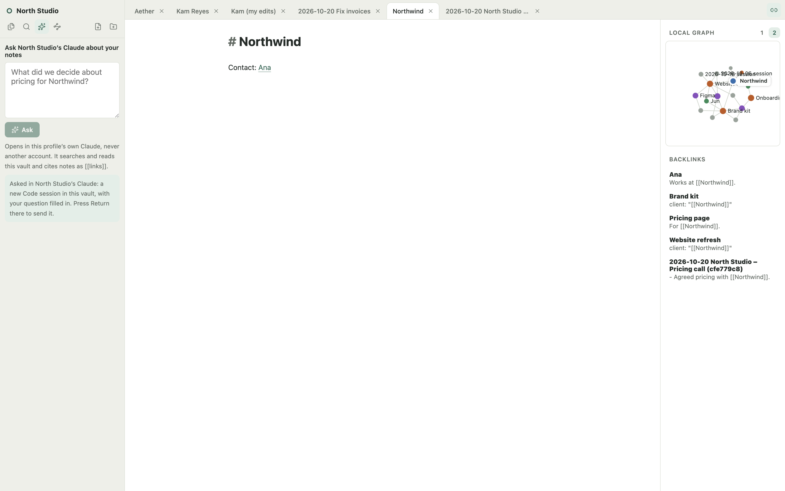

# Hatstand

[](https://github.com/lordkelvinabellana/hatstand/actions/workflows/windows.yml)
[](LICENSE)

**One hat per client.** Keep each client's Claude Desktop account in its own profile, and switch between them without signing out.

**[Website](https://hatstand.vercel.app/)** · **[Download](https://github.com/lordkelvinabellana/hatstand/releases/latest)** · **[Compatibility](docs/COMPATIBILITY.md)**

Hatstand is a small, open-source Windows and macOS launcher for people who use Claude Desktop with several accounts, such as consultants and agencies working for multiple clients. Create a profile per client, sign in once inside the official Claude app, then launch or focus any client from a list, the tray, a keyboard shortcut, or a desktop shortcut. On a Mac, each client also gets a pixel pet in the menu bar that tells you when that account's Claude needs you or has finished.


> [!IMPORTANT]
> Hatstand is an independent project. It is **not affiliated with, endorsed by, or supported by Anthropic**. Claude is a trademark of Anthropic, PBC. Hatstand does not include or modify Claude Desktop; you install Claude separately and sign in inside it.

## Status

**Preview.** It has been tested on Windows 11 x64 with Claude Desktop (MSIX) 1.52386 and 2.110, but several behaviors are not yet verified. Read [what has and hasn't been tested](docs/COMPATIBILITY.md) before relying on it for client work.

Hatstand starts Claude with a separate data folder for each profile by setting `CLAUDE_USER_DATA_DIR`. **Anthropic does not document this setting**, and a Claude update could change or remove it. If that happens, Hatstand shows the profile as failing to start. It does not touch your default Claude sign-in.

## Features

- **One profile per client**: name, color, a pixel pet (or initials) as its picture, and an optional account label you enter yourself.
- **Launch or focus** a client's Claude window, or **open several at once**.
- **Status you can trust**: shows whether that profile's Claude process is running. It never claims an account is signed in, and only reports a task as finished when Claude Code itself says so (see [menu-bar pets](#menu-bar-pets-macos)).
- **Menu-bar pets (macOS)**: one pet per client that shows working, needs input, or done, with its own sound, and a panel of that account's active sessions.
- **Second brain (optional, per profile)**: each profile can keep its own Markdown notes vault. Claude Code logs every session there and keeps notes on clients, projects, people and tools. Off by default; see [Second brain](#second-brain).
- **Notes editor**: open a profile's vault in its own Notes window, with live-preview Markdown, `[[wikilinks]]`, search, backlinks and a graph of how notes link. See [Notes](#notes).
- **Keyboard first**: a global shortcut opens Hatstand (Ctrl+Shift+Space by default), per-profile shortcuts jump straight to a client, and Ctrl+K searches.
- **Windows integration**: tray menu, taskbar jump list, per-client desktop shortcuts, optional start with Windows, and profiles that open at sign-in.
- **Client work folders**: one click to open the client's files. This is a convenience only; it doesn't restrict what Claude can access.
- **Safe data handling**: removing a profile keeps its data by default. Leftover data can be moved to the Recycle Bin (never deleted outright), and uninstalling Hatstand keeps every profile.
- **Metadata export/import**: names, labels, colors, and pets only. Sign-ins never leave your computer.
- **Optional profile sync**: keep the profile list in your own Supabase project so another computer gets the same clients. Off by default; sign-ins and Claude data never sync. See [docs/SYNC.md](docs/SYNC.md).
- Light, dark, and system themes; keyboard navigation; no telemetry.

## macOS preview

macOS support includes a menu bar icon, Dock profile actions, Cmd shortcuts,
start at login, and `.app`/DMG/ZIP packaging. Two simultaneous accounts, retention
after quit/reopen, and sign-out isolation were verified with user confirmation on
Claude Desktop 2.2553.1 on Apple silicon. Reboot retention and Cowork/Code isolation
remain unverified.

Build locally with Node.js 24+ and Xcode Command Line Tools: `npm ci`, then
`npm run make`. The app is in `out/Hatstand-darwin-arm64/` (or `x64` on Intel).
Local previews are not Developer ID signed or notarized. See
[Mac build, verification and signing instructions](docs/MACOS.md).
Mac data is stored in `~/Library/Application Support/HatstandData` and survives
removing the app. The remaining instructions below describe Windows.

### Menu-bar pets (macOS)


Instead of one Claude icon per account, the menu bar shows one pet per client.
Pick it in the profile editor (cat, frog, ghost, bunny, bear, chick, slime or robot);
it is also the client's picture in Hatstand.

| The pet shows | When |
|---|---|
| Asleep, grey | That client's Claude isn't running |
| A bubble with dots, bobbing | Claude Code is working |
| A red **!**, hopping, plus a sound | It asked you something or needs a permission |
| A green **✓**, plus a sound | The whole task is finished: every step of its task list and every background task |

Each pet plays its jingle in its own key, so you can tell by ear which account wants you.
Settings → Menu-bar pets turns the sounds off, or the pets themselves (the Hatstand icon comes back).
Claude's own menu bar icon can be turned off per account in Claude's Settings → General.


Hover a pet for a panel of that account's active sessions: title, project folder, your
last prompt, task progress, background tasks, context and output tokens, and the model.
Click the pet to keep the panel open, and click a session to open that conversation in
the right account's Claude. Right-click for the Hatstand menu.

How it works: Hatstand adds a small hook script (`HatstandData/pet-hook.sh`) to each
profile's Claude Code `settings.json`. The hook writes one tiny file per session
(state, time, transcript path) to `profiles/<id>/pet/`, and the panel reads that
session's local transcript. Nothing is sent anywhere. Opening a session sends a
`claude://code/continue` link to that profile's own Claude process, so macOS asks
once for permission to control Claude.

## Install (Windows)

1. Install [Claude Desktop for Windows](https://claude.com/download).
2. Download `Hatstand-<version> Setup.exe` from [Releases](https://github.com/lordkelvinabellana/hatstand/releases) and run it. A ZIP is also available; extract the whole folder before running `Hatstand.exe`.
3. Optional: verify the download against `SHA256SUMS.txt` from the same release:

   ```powershell
   Get-FileHash '.\Hatstand-0.1.0 Setup.exe' -Algorithm SHA256
   ```

Preview builds are **not code-signed** yet, so Windows SmartScreen may warn about an unknown publisher. Choose **More info → Run anyway** only if the checksum matches.

## Using Hatstand

The first run walks you through three steps: finding Claude, what stays separate, and creating your first client. Then, for each client:

1. Choose **Add profile**, enter the client's name, and pick a color.
2. Choose **Launch**. A new Claude window opens with an empty profile. **Sign in there**; Hatstand never sees your password.
3. Next time, **Launch** reopens that client already signed in, and **Focus** brings its window forward if it's running.

Other everyday actions:

| To… | Do this |
|---|---|
| Open several clients | Tick them in the list, then **Open selected** |
| Jump to a client from any app | Set a **Profile shortcut** in its details |
| Open clients when Windows starts | Turn on **Start with Windows** in Settings, then **Open when Windows starts** on each profile |
| Reorder clients | Drag the handle, or use **Move up/down** in the ⋯ menu |
| Open from a script | `Hatstand.exe --profile="North Studio"` (a name or profile ID) |
| Close a client's Claude | ⋯ → **Close Claude**. If Claude only hides in its tray, use File → Exit in that window, or **Force close** |

Closing the Hatstand window keeps it in the tray. **Quit Hatstand** from the tray to exit; your Claude windows keep running.

## What stays separate, and what doesn't

Each profile gets its own Claude Desktop data folder, so each keeps its own sign-in, chats, and Desktop settings.

Profiles still run as **the same Windows user**. They share your files, clipboard, network, and anything else your account can reach. Hatstand is **not a security sandbox**. For strict separation between clients, use separate Windows accounts or virtual machines.

Cowork and Desktop Code separation, sign-out isolation, and staying signed in after a reboot are **not verified yet**. See [docs/COMPATIBILITY.md](docs/COMPATIBILITY.md).

## Second brain

Turn it on per profile in the profile's details → **Second brain**. That profile then gets its
own notes vault (by default `profiles/<id>/vault`, or a folder you choose), seeded with
`Clients/`, `Projects/`, `People/`, `Tools/`, `Sessions/`, `Daily/`, `_templates/` and a `To-Do.md`.
Vaults are never shared between profiles, so one client's notes stay out of another client's Claude.

Choosing the folder:

- **New vault…** starts in an empty folder.
- **Use existing folder…** adopts a folder that already has notes, such as an Obsidian vault.
  Hatstand shows what it would add (only missing folders, templates and `To-Do.md`) and never
  changes existing notes. The capture hooks append a marked block to an existing `Home.md` and
  to that day's `Daily/` note.
- **Use default** points back at `profiles/<id>/vault`.
- Switching folders never moves or deletes anything. If the current vault has notes, you can copy
  them over; copying never replaces a file that's already there.
- A folder that overlaps another profile's vault or Hatstand data is refused.

**Templates**: while the second brain is on, the Client, Project, Person and Tool templates and the
To-Do format (`_templates/To-Do format.md`, which Claude follows for `To-Do.md`) can be edited in
the same panel. **Restore default** puts Hatstand's version back for that one template.

How it works: Hatstand adds three Claude Code hooks to that profile's `settings.json` and a
marked block of note-keeping rules to its `CLAUDE.md`. The hooks run Hatstand's own capture
script with Hatstand's executable acting as Node (`ELECTRON_RUN_AS_NODE=1`), so nothing else
needs installing:

- **SessionStart** tells Claude which topic notes already exist.
- **Stop / SessionEnd** write one note per session to `Sessions/<month>/` (what was asked,
  files written, skills and apps used) and list the day's sessions in `Daily/`. Secrets,
  random-looking keys and email addresses are redacted from prompts.
- Claude writes the part a script can't: a short summary in each session note, and updates to
  client, project, person and tool notes. Text under `## Summary` and outside the
  `<!-- auto:start -->` … `<!-- auto:end -->` markers is never overwritten.

Turning it off removes only the hooks and the block Hatstand added; notes are never deleted.
A profile that already runs its own `capture.py` hooks is left alone. Only Claude Code sessions
(Code tab) fire hooks, not plain chats. Notes are plain Markdown, so any Markdown editor opens them.

## Notes

**Open notes** (profile actions menu, or the profile's details → Second brain) opens that profile's
vault in its own window. Each window only ever sees its own profile's vault; the check happens in
Hatstand's main process, not the window.



- **Files**: folders and `.md` notes (hidden folders such as `.obsidian` are skipped). New note
  (optionally from a template in `_templates/`, filled with the title and date), new folder, rename
  (double-click), drag onto a folder to move, and **Move to Trash / Recycle Bin**. Nothing is ever
  hard-deleted, and nothing is replaced: a name that's taken gets a number.
- **Live preview** (CodeMirror 6): headings, bold, italic, code, quotes, lists, links and
  checkboxes render in place; the line you're on shows the raw Markdown. Checkboxes are clickable.
- **Wikilinks**: typing `[[` suggests note names and frontmatter `aliases`. Click a link to open it
  (Cmd/Ctrl-click on the line you're editing); a link to a missing note creates it in the vault's
  top folder. Renaming a note offers to update links to it.
- **Search** (Cmd/Ctrl+Shift+F) over names, aliases and text; **Cmd/Ctrl+O** jumps to a note by
  name. The **Backlinks** panel lists notes linking to the open one.
- **Autosave** to the plain `.md` file shortly after you stop typing.
- **Live from disk**: notes Claude writes through the hooks appear as they're written. An open note
  with no unsaved edits reloads by itself. If a note changes on disk while you have unsaved edits,
  nothing is overwritten: choose **Reload theirs**, **Keep mine** or **Keep both** (saves your
  version as `Name (my edits).md`).
- The `<!-- auto:start -->` / `<!-- auto:end -->` markers in session notes are shaded and can't be
  edited by hand, so the capture hook keeps working.

### Graph

The **Graph** button (Cmd/Ctrl+G) opens a graph of the vault as a tab: every note is a dot, every
`[[wikilink]]` a line. Dots are coloured by top folder (Clients, Projects, People, Tools, Sessions,
Daily, everything else) and sized by how many notes they link with.



- Click a dot to open the note; hover to light up its neighbours. **Highlight notes** dims
  everything whose name doesn't match.
- The legend hides or shows each folder. **Hide Sessions and Daily** keeps the graph to clients,
  projects, people and tools; **Hide orphans** drops notes with no links; **Show missing notes**
  adds faint dots for links to notes that don't exist yet (clicking one creates it).
- The graph follows the vault live: notes Claude writes slot in next to what they link to.
- Beside an open note, **Local graph** shows the notes it links with, one or two links away.

### Claude, with your notes

Everything here goes to the profile's **own** Claude account, never another one.



- **Open the session behind a note**: a session note shows **Open in <profile>'s Claude**, which
  opens that Claude Code session in the profile's Claude Desktop (starting it if needed). A session
  that ran in a terminal rather than Claude Desktop just opens the app.
- **Ask** (the sparkles button): type a question and Hatstand starts a new Claude Code session in
  this vault, in this profile's Claude, with your question filled in. Press Return there to send it.
  Claude searches and reads the notes and cites them as `[[links]]`.
- **Recall tools**: with the second brain on, Hatstand adds a read-only MCP server, `hatstand-notes`,
  to the profile's Claude Code and Claude Desktop settings (`search_notes`, `read_note`,
  `note_links`). It can only read that profile's vault. Turning the second brain off removes it.
- On Windows, Hatstand can't hand a link to one particular Claude window, so **Open** and **Ask**
  open the profile's Claude and put the question on the clipboard to paste.

## Where your data lives

| What | Location |
|---|---|
| Profiles, settings, logs | `%LOCALAPPDATA%\HatstandData\` |
| Each profile's Claude session | `%LOCALAPPDATA%\HatstandData\profiles\<profile-id>\` |
| The installed app | `%LOCALAPPDATA%\Hatstand\` (replaced on update, removed on uninstall) |

Profile folders contain signed-in sessions: **treat them like passwords** and never share or upload them. Uninstalling Hatstand leaves `HatstandData` in place. Remove that folder yourself if you want everything gone.

Removing a profile keeps its data unless you tick **Also move this profile's local Claude data to the Recycle Bin**. **Settings → Local data** finds data left behind by removed profiles. Removing a profile doesn't sign out of or delete the Claude account, or any conversations stored by Claude.

Hatstand logs actions with profile IDs only (no names, labels, or paths) and makes no network requests except **Check for updates** in Settings, which contacts the GitHub API when you ask, and, only if you turn it on, **profile sync** with your own Supabase project.

## Development

Requires Node.js 24+. Windows packaging requires Windows x64; Mac builds also require Xcode Command Line Tools. See [macOS development](docs/MACOS.md).

```powershell
npm ci
npm run lint        # Biome formatting and lint checks
npm run typecheck
npm test            # unit tests (node:test)
npm run build
npm run test:ui     # Electron UI tests with synthetic clients; never launches Claude
npm start           # run the app from source
npm run make        # installer and ZIP in out/make/
```

`npm start` uses your real `%LOCALAPPDATA%\HatstandData`. The UI tests use a temporary folder.

See [CONTRIBUTING.md](CONTRIBUTING.md), [docs/ARCHITECTURE.md](docs/ARCHITECTURE.md), and [docs/RELEASING.md](docs/RELEASING.md). Planned work is in [docs/ROADMAP.md](docs/ROADMAP.md).

## Security

Please report vulnerabilities privately, as described in [SECURITY.md](SECURITY.md). Never post profile folders, cookies, account emails, or client content in issues.

## License

[MIT](LICENSE) for Hatstand's code. Claude Desktop is Anthropic's software and is subject to Anthropic's terms. Using several Claude accounts must comply with those terms and with your clients' agreements.
